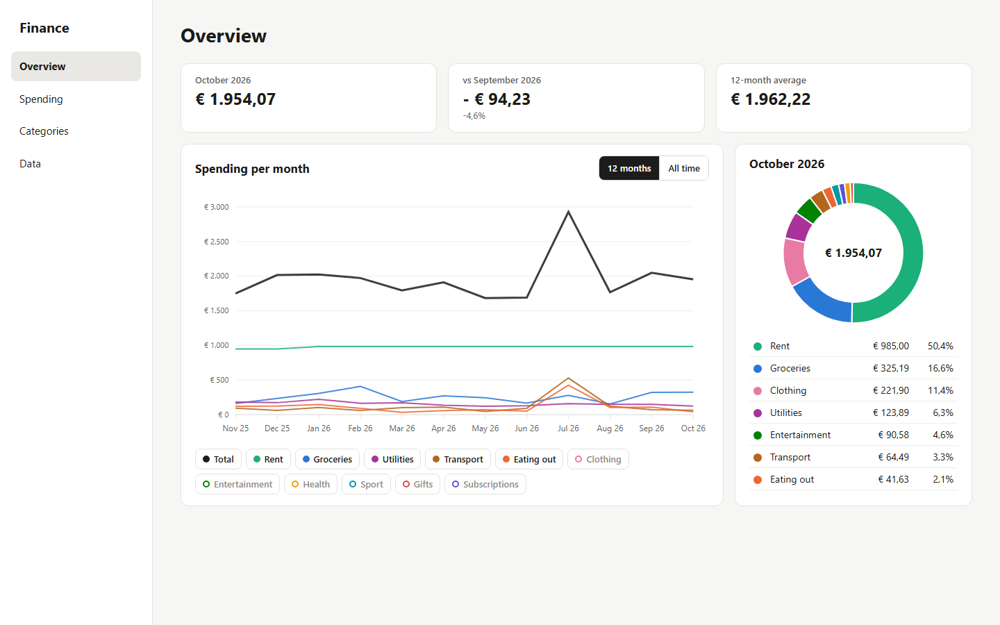

# finance-app

A Blazor Server app (.NET 10) for one person on one PC: each month you enter what you
spent per category, and the overview page shows it. It runs on localhost over plain
http, with no login. Your own spending data stays in `data/`, which git ignores, and
the fast gate refuses any commit that tracks a database or `data/` file.

## Install

Needs the [.NET 10 SDK](https://dotnet.microsoft.com/download). From a clone of this repository:

```sh
dotnet pack src/FinanceApp -c Release
dotnet tool install -g FinanceApp --add-source ./nupkg
```

## Use it

```sh
financeapp        # serve the app at http://localhost:5080
financeapp demo   # serve it at http://localhost:5081 on example data
```

To update after pulling new code, pack again and run
`dotnet tool update -g FinanceApp --add-source ./nupkg`.

## Screenshot

The overview page on the demo data:


